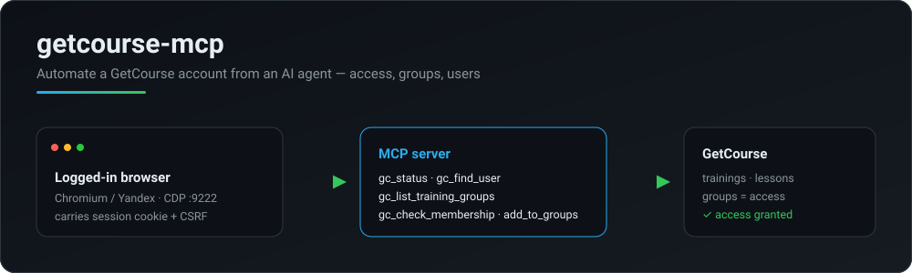

<div align="center">

# getcourse-mcp

**Automate a [GetCourse](https://getcourse.io) account from an AI agent — grant lesson/training access, manage users and groups — with no official API.**

[](https://www.npmjs.com/package/getcourse-mcp)


**English** · [Русский](./README.ru.md)



</div>

## Why

GetCourse has no public API for the things admins do every day — opening a lesson for a student, adding someone to a training, moving users between groups. Those actions live only in the admin UI.

**getcourse-mcp** exposes them as [MCP](https://modelcontextprotocol.io) tools. It drives a **browser you're already logged into** over CDP, so it reuses your real session cookie and CSRF token — no scraping of passwords, no fragile API keys. An AI agent (Claude, etc.) can then find a user, inspect their groups and grant access in one turn.

- 🔑 **Uses your live session** — connects over CDP to a logged-in Chromium/Yandex browser
- 👥 **Access by groups** — the GetCourse model: training/lesson access = group membership
- 🧩 **5 focused tools** — status, find user, list groups, check membership, add to groups
- 🪶 **TypeScript, ESM** — thin, strict, MIT, no account secrets in the repo

## How access works in GetCourse

Access to a training (and its lessons) is granted by **group membership**. "Full access" to a course often means membership in a *Module 1* group plus a group that starts the drip schedule (module 1 now, the rest on a timer). To "give access like another student", read their groups and reproduce them:

```bash
gc_find_user            # student@example.com → id, name
gc_check_membership     # which of these groups is student X in?
gc_add_user_to_groups   # add student Y to the same groups
```

### Franchise / "buyers-only" offers → access via a *completed* purchase

Some offers (franchises, "только купившие" trainings) deliver access **only from a completed purchase** — group membership grants nothing there. Grant it in one call:

```bash
gc_find_offers   {"query":"Трафик Формула"}                            # → offer id, e.g. 6510356
gc_create_order  {"email":"user@x.ru","offerIds":["6510356"],"complete":true}
#   creates the order AND completes a 0₽ payment → access is live immediately
```

⚠️ **A priced deal left in «Новый» delivers NO access** — it must be *paid*. There is no «Оплачен» item in the status dropdown; **completion is payment-driven**. `complete:true` (or a later `gc_pay_order {"dealId":"…"}`) registers a 0₽ *received* payment → deal → «Завершён» → access granted. Use `complete` only for 0₽/comp offers.

A **0₽ order has nothing to pay**, so GetCourse flips it «Новый → Завершен» on creation by itself; `complete:true` then detects the finished deal and touches nothing. Purchase-based access does **not** appear in the user's groups — that's by design, not a bug. Verify it on `/teach/control/stat/user/id/<userId>` (Training / Lesson access), which reflects the grant immediately.

## Requirements

1. A Chromium-based browser (Chrome / Yandex) launched with a debug port on a **separate profile**, logged into your account:

   ```
   browser.exe --remote-debugging-port=9222 --user-data-dir=C:\gc-cdp-profile
   ```

2. Node ≥ 18.

## Setup

```bash
npm install
cp .env.example .env      # set GETCOURSE_BASE_URL (and GETCOURSE_CDP_URL if not :9222)
npm run build
```

Register it with your MCP client (see `.mcp.json.example`):

```json
{
  "mcpServers": {
    "getcourse": {
      "command": "node",
      "args": ["dist/index.js"],
      "env": { "GETCOURSE_BASE_URL": "https://your-account.getcourse.ru" }
    }
  }
}
```

## Tools

| Tool | Purpose |
|------|---------|
| `gc_status` | Check the CDP browser session **actually has admin rights** (not merely that a session exists). Reports the "logged in as a student" case separately. |
| `gc_find_user` | Find a user by email → id, name, type, status. |
| `gc_list_training_groups` | Access groups of a training (id + name). |
| `gc_list_user_groups` | Groups a user belongs to (id + name). |
| `gc_check_membership` | Is a user in the given groups? (instant, via the user list) |
| `gc_add_to_groups` | Add an existing user to groups via the card (preserves other groups). `dryRun`. |
| `gc_remove_from_groups` | Remove a user from groups = revoke access. `dryRun`. |
| `gc_add_user_to_groups` | Add via the bulk import (creates the user if new) = grant access. `dryRun`. |
| `gc_copy_access` | Give a user the same groups as a reference student. `dryRun`. |
| `gc_update_user` | Edit card fields (first/last name, phone, city, comment). Email is out of scope. `dryRun`. |
| `gc_find_offers` | Search sales offers by name → id + price + actuality. |
| `gc_find_orders` | List a user's orders (dealId + status). |
| `gc_create_order` | Create an order = grant access via a purchase (the only way for "buyers-only" trainings, where groups don't grant access). Reports the created deal's id and status; a priced deal in «Новый» means **no access until paid**, `complete:true` drives it to «Завершён». ⚠️ single-step: `dryRun:false` creates the order immediately. |
| `gc_pay_order` | Complete a deal by registering a received payment (`amount` "0" by default) → deal «Завершён» → access delivered. The way to "mark paid" (no «Оплачен» in the status dropdown). ⚠️ don't use `0` on a real paid deal. `dryRun`. |
| `gc_set_order_status` | Change a deal's status (e.g. cancel a duplicate: `cancelled` + `cancelReasonId`). |
| `gc_refund_order` | File a money refund for an order via the GetCourse payment module (real money back to the buyer's card). Only for payments processed by the platform; VAT must mirror the original receipt. `dryRun`. |
| `gc_unlock_modules` | Open modules for a stuck (but paid) student: advance the module-delivery process past its «завершил модуль N» wait (clicks «перейти далее»). `all:true` opens the whole course; default opens the next module. Needs manager/supervisor rights on the process. `dryRun`. |
| `gc_user_summary` | One call: profile + groups + orders for a user. |
| `gc_list_mailing_categories` | List mailing categories (tag-like segmentation) — id + name. |
| `gc_add_to_mailing_category` | Add a user to a mailing category. |
| `gc_remove_from_mailing_category` | Remove a user from a mailing category. |

## Usage

Run the MCP server over stdio, or call a tool directly for scripting:

```bash
node dist/index.js                                   # MCP (stdio)

npx tsx src/run.ts gc_find_user '{"email":"user@example.com"}'
# → Found: Jane Doe | user@example.com | student | active | id: 100200300

npx tsx src/run.ts gc_add_user_to_groups \
  '{"email":"user@example.com","groupIds":["100001","100002"]}'
# → OK [done] import submitted

npx tsx src/run.ts gc_check_membership \
  '{"email":"user@example.com","groups":[{"id":"100001","name":"Module 1"}]}'
# → ✅ Module 1 (100001)
```

## Implementation notes

- **Granting access** (`gc_add_user_to_groups`) uses the bulk *Add users* form (`/pl/user/user/import?type=text`): email + selected groups. For an **existing** user the "overwrite on match" flag is required (`overwriteExisting`, default `true`), otherwise the groups are not applied — the import carries only the email, so no profile data is touched.
- A direct mass action exists (`POST /pl/logic/operation/prepare?operationType=user_addtogroup`), but in the current UI it is a selection-builder wizard — a candidate to wire up as an alternative path.
- **Membership** is checked through the user list filtered by a `user_ingrouprule` rule (`params.value.selected_id`), which reflects membership immediately (the training student list mirrors access asynchronously and is not reliable for verification).
- **Writes never trust their own exit code.** A single-step operation can throw *after* the mutation landed, so `gc_create_order` snapshots the user's deals first and reports the deal that actually appeared — which also removes the "newest deal must be ours" guess.
- **The session check tests rights, not the mere presence of a session.** `gc_status` probes the admin user list (`/pl/user/user`) — the endpoint `gc_find_user`/`resolveUserId` depend on. It used to check `/teach/control`, which renders for students too: a student session reported "✅ logged in" and every later read silently ran as that student. The "denied" signal is anchored on GetCourse's own error-page wording so stray list content can't lock an admin out.
- **`__name` shim.** `page.evaluate` callbacks are serialized and run inside the page. esbuild (what `tsx` runs on) rewrites named inner functions into `__name(...)` calls, which do not exist there — hence `ReferenceError: __name is not defined` under `tsx src/*.ts` while the compiled `dist/*.js` works. Every navigation installs a no-op shim (`ensureEvalShim`), so both entry points behave the same. If you drive `page.goto` yourself, call `ensureEvalShim(page)` after it.

## Contributing

Contributions are welcome — open an issue or a PR. Good first ideas:

- direct `user_addtogroup` mass action instead of the import form
- a "copy all groups from one student to another" tool
- revoking access (`gc_remove_user_from_groups`)
- exporting students; test coverage

1. Fork and branch: `git checkout -b feature/my-change`
2. `npm install`, make changes; `npm run build` and `npx tsc --noEmit` must pass
3. **Never commit secrets** (cookies/passwords/`.env`) or real account data
4. Open a PR describing what and why

## Security

Secrets (cookies/passwords) live only in the browser and your environment — never in the repo. `.env` and a local `.mcp.json` are git-ignored.

## License

MIT
