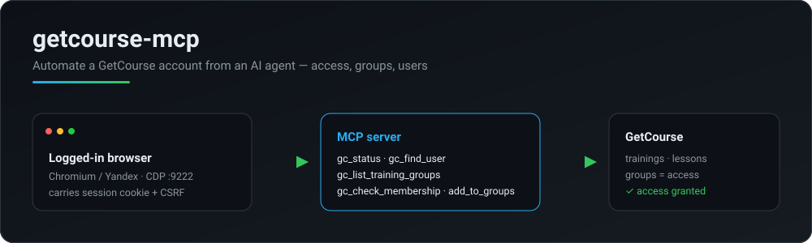

<div align="center">

# getcourse-mcp

**Автоматизация аккаунта [GetCourse](https://getcourse.ru) из AI-агента — выдача доступа к урокам/тренингам, управление пользователями и группами — без официального API.**

[](https://www.npmjs.com/package/getcourse-mcp)


[English](./README.md) · **Русский**



</div>

## Зачем

У GetCourse нет публичного API для того, что админ делает каждый день — открыть урок ученику, добавить в тренинг, переместить между группами. Эти действия живут только в админке.

**getcourse-mcp** отдаёт их как инструменты [MCP](https://modelcontextprotocol.io). Сервер управляет **уже залогиненным браузером** по CDP, переиспользуя реальную session-cookie и CSRF — без выуживания паролей и без хрупких API-ключей. AI-агент (Claude и т.п.) может за один заход найти пользователя, посмотреть его группы и выдать доступ.

- 🔑 **Живая сессия** — подключение по CDP к залогиненному Chromium/Yandex
- 👥 **Доступ через группы** — модель GetCourse: доступ к тренингу/уроку = членство в группе
- 🧩 **5 инструментов** — статус, поиск юзера, список групп, проверка членства, добавление в группы
- 🪶 **TypeScript, ESM** — тонко, строго, MIT, без секретов аккаунта в репозитории

## Как устроен доступ в GetCourse

Доступ к тренингу (и его урокам) выдаётся **членством в группах**. «Полный доступ» к курсу часто = группа «Модуль 1» + группа, запускающая расписание (модуль 1 сейчас, остальные — по таймеру). Чтобы «выдать доступ как у другого ученика», смотрят его группы и повторяют их:

```bash
gc_find_user            # student@example.com → id, имя
gc_check_membership     # в каких из этих групп состоит ученик X?
gc_add_user_to_groups   # добавить ученика Y в те же группы
```

### Франшизы / офферы «только купившие» → доступ по *завершённой* покупке

Часть офферов (франшизы, тренинги «только купившие») выдают доступ **только с завершённой покупки** — членство в группах там не даёт ничего. Выдать одним вызовом:

```bash
gc_find_offers   {"query":"Трафик Формула"}                            # → id оффера, напр. 6510356
gc_create_order  {"email":"user@x.ru","offerIds":["6510356"],"complete":true}
#   создаёт заказ И проводит 0₽-оплату → доступ выдан сразу
```

⚠️ **Платная сделка в статусе «Новый» доступ НЕ выдаёт** — её нужно *оплатить*. В дропдауне статусов пункта «Оплачен» нет — **завершение только через оплату**. `complete:true` (или потом `gc_pay_order {"dealId":"…"}`) проводит 0₽-платёж со статусом «Получен» → сделка → «Завершён» → доступ выдан. `complete` — только для 0₽/комп-офферов.

**0₽-заказ платить нечем**, поэтому Геткурс сам переводит его «Новый → Завершен» при создании; `complete:true` в этом случае видит завершённую сделку и ничего не трогает. Доступ покупкой **не отражается в группах** пользователя — это норма, не баг. Проверять на `/teach/control/stat/user/id/<userId>` (таблица «Тренинг / Доступ к урокам») — там видно сразу.

## Требования

1. Браузер на Chromium (Chrome / Yandex), запущенный с debug-портом на **отдельном профиле** и с входом в аккаунт:

   ```
   browser.exe --remote-debugging-port=9222 --user-data-dir=C:\gc-cdp-profile
   ```

2. Node ≥ 18.

## Настройка

```bash
npm install
cp .env.example .env      # задать GETCOURSE_BASE_URL (и GETCOURSE_CDP_URL, если не :9222)
npm run build
```

Подключение к MCP-клиенту (см. `.mcp.json.example`):

```json
{
  "mcpServers": {
    "getcourse": {
      "command": "node",
      "args": ["dist/index.js"],
      "env": { "GETCOURSE_BASE_URL": "https://your-account.getcourse.ru" }
    }
  }
}
```

## Инструменты

| Инструмент | Назначение |
|------------|-----------|
| `gc_status` | Проверить, залогинен ли админ в браузере (CDP). |
| `gc_find_user` | Найти пользователя по email → id, имя, тип, статус. |
| `gc_list_training_groups` | Группы доступа тренинга (id + название). |
| `gc_list_user_groups` | Группы, в которых состоит пользователь (id + название). |
| `gc_check_membership` | Состоит ли пользователь в группах? (мгновенно, по списку пользователей) |
| `gc_add_to_groups` | Добавить существующего пользователя в группы через карточку (сохраняет остальные). `dryRun`. |
| `gc_remove_from_groups` | Убрать из групп = закрыть доступ. `dryRun`. |
| `gc_add_user_to_groups` | Добавить через импорт (создаёт нового при отсутствии) = выдать доступ. `dryRun`. |
| `gc_copy_access` | Выдать те же группы, что у эталонного ученика. `dryRun`. |
| `gc_update_user` | Изменить поля карточки (имя, телефон, город, комментарий). Email вне области. `dryRun`. |
| `gc_find_offers` | Поиск офферов продажи по названию → id + цена + актуальность. |
| `gc_find_orders` | Список заказов пользователя (dealId + статус). |
| `gc_create_order` | Создать заказ = выдать доступ покупкой (единственный способ для тренингов «только купившие», где группы доступ не дают). Возвращает id созданной сделки и её статус; платная сделка в «Новый» = **доступа нет, пока не оплачена**, `complete:true` доводит её до «Завершён». ⚠️ один шаг: `dryRun:false` создаёт заказ сразу. |
| `gc_pay_order` | Провести оплату по сделке (`amount` «0» по умолчанию) → сделка «Завершён» → доступ выдан. Способ «пометить оплаченной» (в дропдауне статусов «Оплачен» нет). ⚠️ не ставь `0` на реальной платной сделке. `dryRun`. |
| `gc_set_order_status` | Изменить статус сделки (напр. отменить дубль: `cancelled` + `cancelReasonId`). |
| `gc_refund_order` | Оформить возврат денег по заказу через платёжный модуль Геткурса (реальный возврат на карту). Только для платежей через платформу Геткурс; НДС — как в чеке прихода. `dryRun`. |
| `gc_user_summary` | Один вызов: профиль + группы + заказы пользователя. |
| `gc_list_mailing_categories` | Список категорий рассылок (tag-подобная сегментация) — id + название. |
| `gc_add_to_mailing_category` | Добавить пользователя в категорию рассылок. |
| `gc_remove_from_mailing_category` | Убрать пользователя из категории рассылок. |

## Использование

Запуск MCP-сервера по stdio или прямой вызов инструмента для скриптов:

```bash
node dist/index.js                                   # MCP (stdio)

npx tsx src/run.ts gc_find_user '{"email":"user@example.com"}'
# → Найден: Иван Иванов | user@example.com | ученик | Активен | id: 100200300

npx tsx src/run.ts gc_add_user_to_groups \
  '{"email":"user@example.com","groupIds":["100001","100002"]}'
# → OK [done] импорт отправлен

npx tsx src/run.ts gc_check_membership \
  '{"email":"user@example.com","groups":[{"id":"100001","name":"Модуль 1"}]}'
# → ✅ Модуль 1 (100001)
```

## Заметки по реализации

- **Выдача доступа** (`gc_add_user_to_groups`) идёт через форму «Добавление пользователей» (`/pl/user/user/import?type=text`): email + выбор групп. Для **существующего** пользователя обязателен флаг «перезаписать при совпадении» (`overwriteExisting`, по умолчанию `true`), иначе группы не применяются; в импорте только email — данные профиля не теряются.
- Прямой массовый экшен существует (`POST /pl/logic/operation/prepare?operationType=user_addtogroup`), но в текущем UI это визард-выборка — кандидат на альтернативный путь.
- **Проверка членства** — через фильтр списка пользователей по правилу `user_ingrouprule` (`params.value.selected_id`): отражает членство мгновенно (список учеников тренинга обновляется асинхронно и для проверки не годится).
- **Запись не верит своему коду возврата.** Одношаговая операция может упасть уже *после* мутации, поэтому `gc_create_order` снимает список сделок до записи и репортит ту сделку, которая реально появилась, — заодно уходит догадка «самая верхняя сделка наша».
- **Шим `__name`.** Колбэки `page.evaluate` сериализуются и исполняются в странице. esbuild (на нём работает `tsx`) переписывает именованные внутренние функции в вызовы `__name(...)`, которых там нет — отсюда `ReferenceError: __name is not defined` под `tsx src/*.ts` при рабочем скомпилированном `dist/*.js`. Каждая навигация ставит no-op-шим (`ensureEvalShim`), так что оба способа запуска ведут себя одинаково. Если гоняете `page.goto` сами — вызовите после него `ensureEvalShim(page)`.

## Вклад (Contributing)

Буду рад issue и PR. Хорошие идеи для старта:

- прямой массовый экшен `user_addtogroup` вместо импорта
- инструмент «скопировать все группы одного ученика другому»
- снятие доступа (`gc_remove_user_from_groups`)
- экспорт учеников; покрытие тестами

1. Форк и ветка: `git checkout -b feature/my-change`
2. `npm install`, правки; `npm run build` и `npx tsc --noEmit` должны проходить
3. **Не коммитьте секреты** (куки/пароли/`.env`) и данные реальных аккаунтов
4. Откройте PR с описанием, что и зачем

## Безопасность

Секреты (куки/пароли) — только в браузере и окружении, никогда в репозитории. `.env` и локальный `.mcp.json` в `.gitignore`.

## Лицензия

MIT
